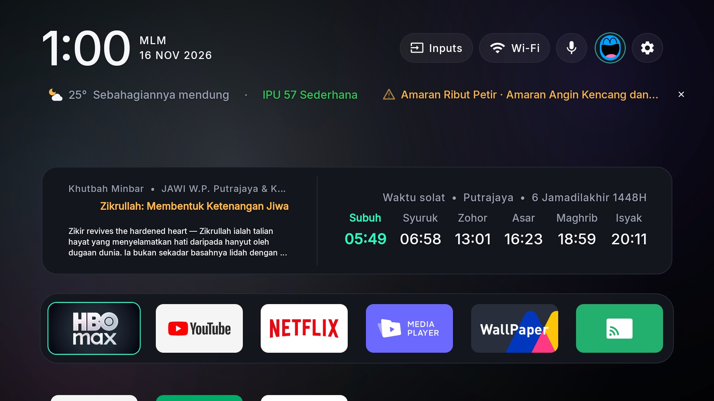
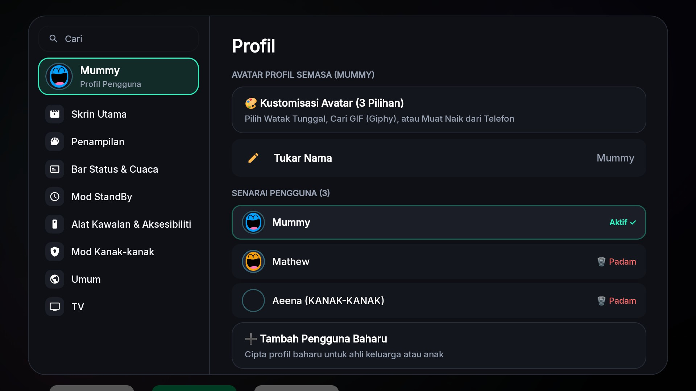
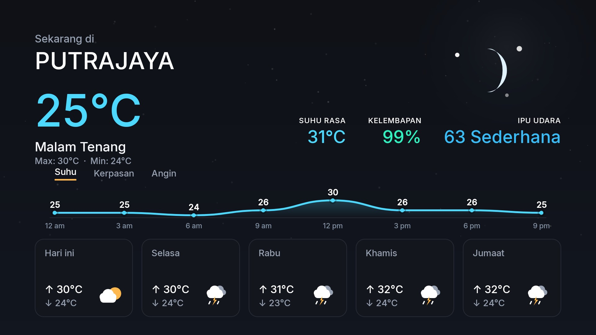

# Glass TV — Sinar

**Make your Android TV or Google TV fast and ad-free again, then come home to a calmer screen: Sinar folds
the weather, daily ayah and prayer times into one flat information rail above the dock, with one vivid accent
and no glass, blur or heavy shadows.**

> A fork of [Glass TV](https://github.com/aqmangge/glass-tv-home) by [@aqmangge](https://github.com/aqmangge).
> The launcher engine and every feature from Glass TV v4.1.0 are here; the home screen, settings, dialogs,
> typography and wallpaper set are rebuilt in this fork with the Sinar design language. The fork's own home is
> [muhaafidz/glass-tv-home](https://github.com/muhaafidz/glass-tv-home).

<p align="center">
  
</p>

<p align="center">
  <em>Sinar home on a Xiaomi Mi TV (Android TV 10). Flat graphite surfaces, one electric-mint accent, and app-coloured focus.</em>
</p>

<p align="center">
  <a href="https://github.com/muhaafidz/glass-tv-home/raw/main/release/glass-tv-home.apk">
    
  </a>
  &nbsp;
  <a href="https://github.com/muhaafidz/glass-tv-home/raw/main/release/glass-tv-installer.apk">
    
  </a>
</p>

> 🚨 **AMARAN PENTING: JANGAN SIDELOAD APK SECARA MENTAH!**
> Ramai pengguna memuat turun fail APK secara terus melalui pendrive USB atau aplikasi *Downloader* di TV. **Ini adalah satu kesilapan besar pada Android TV & Google TV!**
> - Firmware Android TV akan melayan Glass TV sebagai aplikasi biasa dan bukannya sistem pelancar utama.
> - Apabila anda menekan butang **HOME** pada remote TV, sistem tetap akan kembali ke skrin utama asal pengeluar yang sarat dengan iklan dan bloatware.
> - Pelayan muat naik gambar mungkin terhalang jika port disekat, dan resolusi paparan tidak diselaraskan.
> 
> 👉 **GUNAKAN 2 KAEDAH PALING PRAKTIKAL & MUDAH DI BAWAH:**
> 1. 🤖 **Kaedah 1 (Paling Disyorkan — 1-Baris Prompt AI)**: Salin prompt di [AI_INSTALL_PROMPT.md](AI_INSTALL_PROMPT.md) ke pembantu AI (Google Antigravity, Claude Code, Cursor). AI akan mengaudit versi TV, resolusi 1080p vs 4K, DPI, dan mengunci butang Home secara automatik!
> 2. 📱 **Kaedah 2 (Tanpa PC — Aplikasi Telefon Android)**: Pasang [**`release/glass-tv-installer.apk`**](https://github.com/muhaafidz/glass-tv-home/raw/main/release/glass-tv-installer.apk) di telefon pintar anda. Sambung ke Wi-Fi sama, dan tekan *Pasang Terus ke TV* untuk kunci butang Home dalam 1-klik tanpa komputer!

> 📦 **Official APK Downloads**:
> - 📺 **Android TV / Google TV Launcher**: [**`release/glass-tv-home.apk`**](https://github.com/muhaafidz/glass-tv-home/raw/main/release/glass-tv-home.apk) (**v5.0.0** • ~2.1 MB)
> - 📱 **Phone / Tablet Companion Installer**: [**`release/glass-tv-installer.apk`**](https://github.com/muhaafidz/glass-tv-home/raw/main/release/glass-tv-installer.apk) (**v1.1.0** • ~7.1 MB) — Kunci butang Home TV terus dari telefon tanpa sebarang PC!
>
> 🤖 **AI Prompt & Audit Guide**:
> - ⚡ **[AI_INSTALL_PROMPT.md](AI_INSTALL_PROMPT.md)**: Arahan lengkap AI untuk audit TV (1080p vs 4K, DPI, IP LAN, stock launcher), debloat, dan kunci butang Home.
> - 📋 **[PROMPT.md](PROMPT.md)**: Format prompt pantas 1-baris untuk semua coding assistants.
>
> 📖 **User Guides / Panduan Pengguna**:
> - 🇬🇧 **English User Guide**: Complete beginner walkthrough, 1-line AI setup, remote navigation, phone setup & FAQ in [USER_GUIDE.md](USER_GUIDE.md).
> - 🇲🇾 **Panduan Bahasa Melayu**: Panduan lengkap langkah demi langkah untuk pengguna baru di [PANDUAN_PENGGUNA.md](PANDUAN_PENGGUNA.md).

Glass TV debloats any Android TV or Google TV over Wi-Fi, with no root and nothing that can't be undone, then
swaps the ad-filled home screen for a calm, fast one. This fork keeps the debloat tools and the v4.1.0
launcher features, and rebuilds the interface in **Sinar**: flat graphite surfaces, one electric-mint accent,
app-coloured focus, and no blur or glass. The home folds a quiet weather and air-quality line, a daily ayah or
Khutbah Minbar shelf, all six prayer times, and the app dock into one information rail. The old place caption
is off by default, so your wallpaper stays unobstructed.

## What's New in This Fork — Sinar

- **Flat, vivid, lightweight.** The glass blur, translucent rims and heavy shadows are gone. Surfaces are flat
  graphite, the primary accent is electric mint, and every focused tile or pill gets a crisp accent edge in the
  app's own colour.
- **Faster settings.** The right pane is rebuilt only when the selected tab changes, the avatar JSON is cached,
  avatars are not rebuilt when unchanged, and focus animations switch off automatically on low-spec TVs.
- **One information rail.** Weather, the daily ayah or Khutbah Minbar, and all six prayer times share one flat
  rail above the dock. The next prayer is mint; the rest stay quiet.
- **Sinar wallpapers.** `themes/sinar` ships five flat graphite gradients (mint, violet, ember, forest, sand)
  with one vivid accent zone, tuned for white launcher text and rotated every 30 minutes.
- **Every surface follows the language.** Settings, profile pickers, dialogs, Inputs, the weather screen and
  recent apps are flat dark sheets with mint focus and app-coloured accents.
- **Everything from Glass TV v4.1.0 is inherited.** Khutbah Minbar, the weather and air-quality hub, multi-user
  profiles, child mode, recent apps, the StandBy screensaver and the debloat tools are still here.

<p align="center">
  
  
</p>
<p align="center">
  <em>The Sinar interface: flat graphite surfaces, one electric-mint accent, app-coloured focus. Apply the
  wallpaper set with <code>TV_HOST=&lt;tv-ip&gt; tools/theme.sh themes/sinar</code>.</em>
</p>

## What's New in Version 4.1 (Inherited from Glass TV)

- **🕌 Localized Weekly Friday Sermons (Khutbah Minbar Tempatan)**:
  - Automatically fetches and displays official localized Friday sermon excerpts based on the selected TV prayer zone / state.
  - Multi-region official sources supported:
    - **Malaysia**: JAWI (W.P. Putrajaya & Kuala Lumpur), JAIS (Selangor), JAINJ (Johor), JAIPP (Pulau Pinang), Perak, Kedah, Perlis, Negeri Sembilan, Terengganu, MAIK (Kelantan), Sabah, and Sarawak via `minbar.gosolat.com`.
    - **Singapore**: MUIS (Majlis Ugama Islam Singapura).
    - **Indonesia**: Kemenag RI (Kementerian Agama RI) & NU Online via `islam.nu.or.id`.
  - Built-in comprehensive offline fallback database ensures the sermon shelf is never blank even with slow or offline network connections.
- **🎛️ Dual Display Mode Switcher (Pilihan Kandungan Paparan)**:
  - Toggle anytime between **Doa Harian (Daily Ayat & Translation)** and **Khutbah Minbar (Weekly Friday Sermon)** in Modern Settings under *Skrin Utama*.
- **🔍 Interactive Frosted Glass Detail Dialog**:
  - Clicking or pressing `DPAD Center (OK)` on the Ayah/Minbar shelf pops up a rich frosted glass modal displaying the sermon's full title, authority badge, date, theme, and complete sermon excerpt, with an instant 1-click toggle button.
- **⛅ Next-Gen Leanback Weather & Air Quality Hub**:
  - Full-screen widescreen Leanback weather hub (`WeatherActivity`) featuring 24-hour temperature curve graphs, tab switching between Temperature, Precipitation, and Wind curves, 5-day daily forecast cards, and official Malaysian DOE (JAS APIMS / IPU) air quality indices with color spectrum gauges and health advisories.
- **⚙️ Modern 2-Column Frosted Glass Settings Engine**:
  - Dual-column Leanback layout with frosted glass backdrop: left categories (*Wallpaper, Suara & Konsol, Skrin Utama, Lokasi & Waktu Solat, Profil, Kunci Kanak-Kanak, TV & Sistem*) and dynamic real-time action panes on the right.
- **👤 Multi-User Profiles & Animated Lottie Avatar Customizer**:
  - Expressive animated Lottie character avatar faces with 8 emotions (Senyum, Kenyit, Bersiul, Mengantuk, Ketawa, Ceria, Ingin Tahu, Terkejut), 8 customizable body palette colors, 8 background palette colors, Tenor GIF avatar search, and local Wi-Fi mobile photo upload.
- **🛡️ Child Mode Security (4-Digit PIN Lock & App Hiding)**:
  - Complete parental control suite: master activation switch, 4-digit security PIN lock, app drawer hiding, and direct launch blocking for adult or restricted applications.
- **🎮 Seamless Remote DPAD Navigation Flow**:
  - Smooth bi-directional TV remote control:
    - `▲ (Up)` from Dock apps slides directly onto the Ayah/Minbar shelf with an animated luminous cyan focus glow.
    - `▲ (Up)` from Ayah/Minbar shelf steps straight onto the Top Bar Settings cog (`⚙️`).
    - `▼ (Down)` from Settings steps down to the Ayah/Minbar shelf, and down again to the Dock tiles.

---

## What's New in Version 4.0

- **Top Bar Active User Avatar Switcher**: The top bar user button dynamically displays the currently active user's **animal avatar icon** (Fox, Panda, Tiger, Lion, Frog, Koala, Octopus) inside a circular accent status ring (Cyan for adult, Amber for child mode). Users immediately see which family ID is currently active.
- **Multi-User Profile & Child Mode Engine**: Create up to 10 independent family profiles with custom names and animal avatars. Features dedicated **Child Mode** with PIN protection, individual app locking, and hidden app management.
- **Self-Adapting 1080p & 4K UHD Hardware Engine**: Automatically audits display modes (`Display.getMode()`), supporting 4K UHD 60Hz panels with smooth 1080p 60fps UI framebuffers. Safely downsamples 48MP/8K phone camera wallpapers using `inSampleSize` and `RGB_565` to prevent Out-Of-Memory crashes on 1GB/2GB TVs.
- **Fail-Safe Local HTTP Wallpaper Server**: Automatically binds across ports `8080 -> 8888 -> 8081 -> dynamic port 0` so that local Wi-Fi QR wallpaper upload from mobile never fails due to port blocking.
- **Default Launcher Card in Settings (TV & Sistem)**: Built-in system card detecting default launcher status and providing direct TV settings navigation and ADB locking commands.

## What you get

- **Recent Apps & RAM Manager (Double-Press Home).** A native tvOS-style 3D CoverFlow app switcher and memory optimizer:
  - **Double-Press Home Button**: Double-pressing the remote's Home button from anywhere on the TV brings up the frosted glass Recent Apps deck.
  - **Double-Press Home to Close All**: Double-pressing Home again while inside the Recent Apps screen triggers `Close All` immediately—killing all background tasks and clearing memory in one step!
  - **Genuine Force-Stop Automation**: Integrates Accessibility automated force-stop to cleanly and completely terminate even stubborn foreground media apps (e.g. video players, streaming apps) that resist standard background process termination.
  - **Live RAM Gauge**: Real-time memory consumption display (`RAM 1.8 GB used of 2.3 GB`) with a sleek recessed progress bar.
  - **Individual App Dismissal**: Press `▲ (Up)` on any app card to slide it away, force-stop its process, and immediately reclaim RAM.
  - **Close All Button**: Click the circular `Close All` button (`🗑️`) at the end of the carousel to kill all running apps at once.
- **Weather & Air Quality Engine.** A full-screen Leanback weather hub (`WeatherActivity`) accessible directly from the under-clock pill:
  - Current condition, apparent temperature, humidity, wind velocity, UV index, sunrise and sunset times.
  - Air Quality Index (AQI / API / IPU) from Malaysia's Jabatan Alam Sekitar (APIMS) with a multi-color spectrum gauge, station comparisons, PM2.5 / PM10 readings, and health advisories.
  - Next 12 Hours hourly forecast pills and 7-day daily forecast cards with precipitation probabilities.
- **Islamic Prayer Timetable & Daily Ayat.** A mindful cultural shelf:
  - 6-phase timetable (Subuh, Syuruk, Zohor, Asar, Maghrib, Isyak) with emerald highlighting for the active prayer window.
  - Daily Quranic Ayat of the Day with Arabic calligraphy and translations.
- **StandBy Ambient Mode & Smart Energy Lifecycle.**
  - **10 Minutes Idle**: Automatically engages an ambient StandBy screensaver with large 110sp numerals, Islamic Hijri calendar, next prayer capsule, and a late-night red monochrome wind-down mode.
  - **2 Hours Later**: Automatically turns off the TV display into deep sleep standby via Android's Accessibility Service (`GLOBAL_ACTION_LOCK_SCREEN`).
- **Frosted Glass Settings Dropdown & 4K Wallpaper Categories.**
  - **Floating Glass Dropdown**: Clicking the top Settings icon (`⚙️`) opens a native Apple tvOS-style glass menu under the button.
  - **Dynamic 4K Wallpaper Switcher**: Switch themes on the fly between *Natural*, *🇲🇾 Malaysia (Koleksi 14 Negeri & Wilayah)*, *Skyscraper* (KLCC, Manhattan, Chicago, Dubai, HK), *Deep Space*, *Ocean & Coastal*, *Minimalist Dark*, or trigger *Next Wallpaper*.
  - **🇲🇾 Malaysia 14 States Sub-Dropdown**: Dedicated sub-dialog to choose wallpapers specifically for any of Malaysia's 14 states (Johor, Kedah, Kelantan, Melaka, Negeri Sembilan, Pahang, Perak, Perlis, Pulau Pinang, Sabah, Sarawak, Selangor, Terengganu, Wilayah Persekutuan) or rotate all states together.
  - **Built-in Haze & Prayer Zone Selectors**: Select from 30+ Malaysian DOE (JAS APIMS) air quality stations and 35+ official JAKIM prayer zones without needing a computer or AI.
  - **All Settings Shortcut**: Access standard Android TV settings in one click (or by long-pressing Settings).
- **Phone QR Wallpaper Upload & Gallery Manager (Phone-to-TV).**
  - **Instant QR Code Wi-Fi Upload**: Scan the QR code on TV with any phone to open a frosted glass web uploader. Send personal high-res wallpapers straight to TV with zero third-party cloud apps.
  - **Full Mobile & TV Photo Manager**: Manage uploaded wallpapers directly on mobile or TV with remote D-pad. Lock a single picture as permanent wallpaper (`📌 Single Mode`), switch back to rotating slideshow (`🔄 Putar Semua`), or delete unwanted pictures (`🗑️`).
  - **Clean View for Custom Wallpapers**: Description/hero text shelf is automatically hidden (`View.GONE`) for custom wallpapers so personal photos remain 100% unobstructed.
- **Console Sound Effects & Mute Toggle (PS5, Nintendo Switch, Xbox).**
  - **3 Iconic Console Profiles**: Choose your favorite sound profile from the Settings menu (`⚙️`):
    - **PlayStation 5**: Futuristic soft swooshes and acoustic tactile clicks.
    - **Nintendo Switch**: Crisp mechanical snap and bright affirmative chime.
    - **Xbox Series X/S**: Resonant warm mid-bass navigation blips and two-tone modern rising chime.
  - **Mute / Silent Mode (`Off`)**: Toggle sound effects completely off for a whisper-quiet late-night browsing experience.
  - **Live Audition**: Plays instant sound previews upon selecting an option in the dialog.
  - **Persistent Memory**: Saved across reboots and app launches via TV shared preferences.
- **OTA In-App Auto Update & 1-Line AI Patching.**
  - **In-App OTA Check (`⚙️ Check for Updates`)**: Check, download, and install latest APK patches directly on the TV without a PC.
  - **Background Launch Check**: Glass TV silently checks for new releases on startup and prompts when a new update is ready to install.
  - **1-Line AI Update Prompt**: Paste `update patch latest glass tv dekat tv rumah saya: https://github.com/muhaafidz/glass-tv-home` to any AI coding assistant to upgrade via ADB in 5 seconds without touching existing user data.

- **Keeps itself clean.** Every 15 days, while Home sits idle, the TV clears its app caches, where the Play
  Store leaves gigabytes of download leftovers that can make apps open to a blank screen. No computer needed,
  sign-ins and app data are never touched; the TV asks once to allow it.
- **Glass, like Apple's.** The dock's tray, the top-bar buttons and the menus show the picture behind them
  softened, with a shine along their edges. Android 10 has no live blur, so the picture is blurred once each
  time it changes and the glass draws its patch of it.
- **One selection that glides.** Between apps it is a pane of glass with the app's shadow under it; on the top
  bar and in the menus it is dark. It glides and changes shape from one to the next, never jumps.
- **Places to visit that renew themselves.** Once a week the TV takes the pictures Bing has shown on its home
  page over the past days — landmarks, landscapes, wildlife — deletes last week's and rotates through them,
  dimmed so the clock and tiles stay readable. Quiet Canvas hides the place caption by default, so the picture
  stays clean; turn it back on in wallpaper settings if you want the name and country. Pictures with people in
  them are skipped: by the words in their caption, and by Android's own face detector on the TV. No key, no
  account, nothing to set up.
- **Every app tints the room.** The glow behind Home, and the glass with it, blends to the colour of whichever
  app is selected.
- **Arrange your apps from the remote.** Hold OK on an app for a glass menu with **Move** and **App info**.
  Move picks the app up: it wiggles, the arrows carry it (into or out of the dock too) and the other apps
  slide aside; OK puts it down. The order is kept, and apps installed later join at the end.
- **An Inputs menu in glass.** The selection glides out of the Inputs button into the list of HDMI and AV
  inputs, and Up from the top of the list glides it back.
- **Comes back as you left it.** Back from an app, the app you left is still selected; pressing Home on Home
  goes to the first app. When Android has closed Home to free memory, it comes back whole in one frame,
  with no black screen and no half-built dock.
- **A StandBy clock screensaver.** A sleek, high-contrast OLED digital nightstand clock with 110sp digits,
  Islamic Hijri calendar, next prayer countdown capsule, and gentle minute-by-minute drift to prevent burn-in.
- **Rows feather out under the top bar** instead of being cut off when you scroll, and the Wi-Fi / Ethernet
  button can be hidden (`show_network_pill`).
- **Rotating wallpapers of your own** instead, with `"places": false`: put pictures in a theme's `wallpapers/`
  folder and choose how often they change, down to every 5 seconds. Each picture is decoded in the background
  and cross-faded. The bundled `quiet-canvas` theme is a ready-made five-image example.

Still light: on a Xiaomi Mi TV with 1.8 GB of RAM the launcher uses about 80–100 MB and stays there over hours
of use, one wallpaper is in memory at a time, the week's places take about 2 MB of storage, and nothing runs
while you are inside an app.

## Setting it up (By Device Priority)

Choose the setup method based on your available devices:

### ⭐ Priority 1: Android Phone (Primary Focus — 1-Click Wireless & Zero PC)
Install directly from your Android phone or tablet without any computer or cables:
1. Turn ON **USB debugging** on TV (*Settings ⚙️ $\rightarrow$ About $\rightarrow$ click Build 7 times $\rightarrow$ Developer options*).
2. Install [**`release/glass-tv-installer.apk`**](https://github.com/muhaafidz/glass-tv-home/raw/main/release/glass-tv-installer.apk) on your Android phone.
3. Open the app, tap **`🔍 Imbas Android TV di Rangkaian Wi-Fi`**, then tap **`🚀 Pasang Terus ke Android TV`** and press **Allow** on your TV screen!

### 💻 Priority 2: If No Android Phone — Use Laptop or PC (1-Line AI Setup)
Using a computer with an AI assistant (**Google Antigravity** [Free], **Claude Code** [Paid], **Cursor**)?
1. Enable **USB debugging** on your TV and connect to the same Wi-Fi.
2. Paste this single line to your AI assistant:
   ```text
   install ni dekat tv rumah saya: https://github.com/muhaafidz/glass-tv-home
   ```
   *(Or in English: `install this on my home tv: https://github.com/muhaafidz/glass-tv-home`)*
3. The AI connects over Wi-Fi, creates a backup, removes sluggish ads & bloatware, and installs Glass TV Home automatically!

### 🍏 Priority 3: If No Android & No PC (iPhone Users) — Use iPhone & Muse.ai Assistance
Only have an iPhone/iPad?
1. Open Safari on iPhone and visit [**muse.ai**](https://muse.ai) for interactive AI assistance:
   > *"I have an iPhone and an Android TV [model]. Guide me step-by-step to install https://github.com/muhaafidz/glass-tv-home and give me a debloat list of useless apps to disable on my TV."*
2. Install the APK via TV's **Downloader** app or **LocalSend**, then disable manufacturer bloatware from TV Settings following Muse.ai's recommendations.

---

### 🔄 1-Line AI Update / Patch Prompt (For Existing Users)
Already have Glass TV installed and want to update to the latest release or patch? Paste this single line to your AI:
```text
update patch latest glass tv dekat tv rumah saya: https://github.com/muhaafidz/glass-tv-home
```
*(Or in English: `update glass tv to the latest patch on my tv: https://github.com/muhaafidz/glass-tv-home`)*

> 🚨 **AI Update Rule / Arahan Khas AI Kemas Kini**:
> When a user requests to update/patch Glass TV:
> 1. Connect to the TV over Wi-Fi (`adb connect <TV_IP>:5555`).
> 2. Install the latest prebuilt APK without wiping user data (`adb install -r release/glass-tv-home.apk`).
> 3. Relaunch the launcher (`adb shell am start -n com.gathin.tvhome/.MainActivity`).
> 4. All personal wallpapers, dock orders, and settings are 100% retained!

> 🚨 **AI Assistant Rule / Arahan Khas AI**:
> When installing for a user, the AI **must ask the user for their location in Malaysia** (e.g. Putrajaya, Cheras, Shah Alam, Melaka, JB, Penang, Kuantan, Kuching, KK) to configure live JAS haze/IPU data and JAKIM prayer times via:
> ```bash
> adb shell am broadcast -a com.gathin.tvhome.SET_LOCATION -p com.gathin.tvhome --es query "<LOCATION>"
> ```
> If installed manually without AI, users can change the station at any time directly on the TV using the remote control under **Settings (⚙️) $\rightarrow$ Location API Haze** or **Weather Dashboard $\rightarrow$ 📍 Tukar Stesen / Change**.

> 📖 **Read the Beginner User Guides**:
> - 🇬🇧 **[USER_GUIDE.md](USER_GUIDE.md)**: Full English step-by-step guide (Developer Mode, AI prompts, manual station selector, iPhone & Android setups, FAQ).
> - 🇲🇾 **[PANDUAN_PENGGUNA.md](PANDUAN_PENGGUNA.md)**: Panduan penuh Bahasa Melayu untuk pengguna baru (aktifkan Developer Mode, arahan AI, tukar stesen manual remote TV, telefon pintar & FAQ).

The full step-by-step guide for debloating and installing is in
[docs/CLEANYOURTV-README.md](docs/CLEANYOURTV-README.md), and [PROMPT.md](PROMPT.md) lets a coding assistant do
it for you. In short:

```bash
python3 -m venv tools/venv && tools/venv/bin/pip install -r tools/requirements.txt
export TV_HOST=192.168.1.50                                   # your TV's IP address
tools/disable.sh examples/<your tv>/debloat.txt               # debloat
launcher/build-and-install.sh                                 # build the launcher and make it Home
tools/theme.sh themes/<your theme>                            # push your settings and wallpapers
```

Glass TV clears the TV's caches by itself every 15 days ([how](docs/cache-clean.md)). To clean several TVs
from one computer instead, [`tools/cache-clean.sh`](docs/cache-clean.md) finds the TVs on your network and
clears their caches, leaving sign-ins and app data untouched.

## Which TVs work

Android TV and Google TV, Android 8 or newer, on the TV or on a box plugged into any TV.
[docs/DEVICES.md](docs/DEVICES.md) lists every tested model and how far each was tested: end to end with
Glass TV, with the original launcher, or debloat only, plus what is expected to work and what cannot.

### 🇲🇾 Unifi TV Box (TM Unifi Plus Box) Compatibility & Warranty
- **Can I use it on Unifi TV Box?** **Yes!** Unifi Plus Box (Skyworth HP40A3, ZTE B866V2K, and newer TM Android TV boxes) runs certified Android TV. You can install Glass TV Home via APK sideloading or wireless ADB. The official **unifi TV** app remains fully operational so you never lose live TV channels or subscriptions.
- **Will it void the warranty?** **No, it will NOT void your warranty.** Glass TV Home is a standard user-space Android APK. It does **not** root the box, unlock the bootloader, or modify system firmware. You can uninstall it at any time from *Settings > Apps > Glass TV Home > Uninstall* or factory reset the box to return it 100% to its original TM factory state.

## LG and Samsung TVs

LG TVs run webOS and Samsung TVs run Tizen; neither can run Android apps, and neither lets any app replace its
home screen or the Home button. For the full Glass TV, plug in a Google TV or Android TV box (Chromecast with
Google TV, Xiaomi Mi Box, NVIDIA Shield): the TV becomes the screen and Glass TV is Home. On LG, a version you
open as an app is in preview in [webos/](webos/README.md).

## Places, or pictures of your own

Places are on from the start. To change how often the picture changes, or to use your own pictures and keep
the launcher offline, make a theme folder with a `config.json` like this and push it with `tools/theme.sh`:

```json
{
  "places": false,
  "wallpaper_seconds": 15,
  "show_network_pill": false
}
```

All keys are listed in [themes/README.md](themes/README.md). With `"places": false`, the launcher never goes
online.

### Quiet Canvas themes

This fork ships two ready-made themes:

| Theme | What it is |
|---|---|
| `themes/quiet-canvas/` | Five 1920×1080 colourways — cool, ember, forest, graphite and sand — rotating every 30 minutes |
| `themes/quiet-canvas-ember/` | The warm ember still on its own, if you prefer a single colourway |

Apply the collection without rebuilding:

```bash
TV_HOST=<tv-ip> tools/theme.sh themes/quiet-canvas
```

To preview the layout and switch wallpapers without a TV or emulator, open
[`preview/quiet-canvas.html`](preview/quiet-canvas.html) in a browser.

## Credits and licence

- Built on [CleanYourTV](https://github.com/Gathin23/cleanyourtv) © 2026 Gathin, MIT licence — see
  [LICENSE](LICENSE). Its debloat lists, tools and launcher are the foundation of this project.
- Glass TV is maintained upstream by [@aqmangge](https://github.com/aqmangge); this Quiet Canvas fork is
  maintained by [@muhaafidz](https://github.com/muhaafidz).
- The Outfit typeface is under the SIL Open Font License (`launcher/FONT-LICENSE-OFL.txt`).
- The Inputs icon is from Google's Material Icons (Apache 2.0).
- The Quiet Canvas wallpapers are generated gradients that live in `themes/quiet-canvas/`; the editable SVGs
  are included.
- Pictures of places and their captions are Bing's daily images (Microsoft). The launcher fetches them on your
  own TV when `places` is on.
- Gotham, used in the legacy promo pictures only, is a Hoefler&Co. typeface and is not part of this repository.
